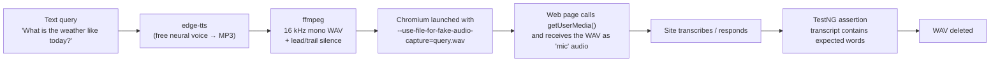

# Fake-Mic Voice Testing with Playwright

Automated testing of voice-driven web apps **without a human speaking**.

A test turns a text query into speech, feeds it to Chromium as if it came from a microphone,
and asserts on what the web page does with it. The demo target is
[Whisper Web](https://huggingface.co/spaces/Xenova/whisper-web), a free, public, no-login
speech-to-text site. The same technique works for any voice bot, voice search, or dictation feature
that uses the browser microphone.

---

## How it works



### Step 1 — Generate the voice query (`VoiceQueryGenerator`)

| Stage | Tool | Why |
|---|---|---|
| Text → speech (MP3) | [`edge-tts`](https://github.com/rany2/edge-tts) | Free, no API key, natural Microsoft neural voices in many languages/accents |
| MP3 → WAV | `ffmpeg` | Chromium's fake mic needs **WAV (PCM)**. We use 16 kHz, mono, 16-bit |
| Add 1.5 s silence before | `ffmpeg adelay` | Gives the page time to open the mic, so the first word isn't cut off |
| Add 3 s silence after | `ffmpeg apad` | Lets voice-activity detection "see" the speaker stop talking |

The WAV is written to the OS temp folder with a unique name (`voice_query_*.wav`). The intermediate
`.txt` and `.mp3` files are deleted straight away.

### Step 2 — Launch a browser with a fake microphone (`FakeMicBrowser`)

Three Chromium flags do all the work:

| Flag | Effect |
|---|---|
| `--use-fake-device-for-media-stream` | Replace real audio/video hardware with fake devices |
| `--use-fake-ui-for-media-stream` | Auto-accept the "Allow microphone?" prompt |
| `--use-file-for-fake-audio-capture=<path.wav>` | The fake microphone plays this file (on a loop) |

The browser context is also granted the `microphone` permission. Because the file is fixed when the
browser launches, **each query gets its own browser**.

### Step 3 — Drive the site like a user (`WhisperWebTranscriptionTest`)

1. Open Whisper Web → **Record** → **Start Recording**
2. Wait for exactly the WAV's duration (one play-through), then **Stop Recording** → **Load**
3. **Transcribe Audio**. The first time, the browser downloads the Whisper model (~40 MB)
4. Click the site's own **Export TXT** and capture the download. That gives the exact transcript,
   with no fragile DOM scraping
5. Assert that the transcript **contains the key words**, not an exact string (see below)

### Step 4 — Clean up

`@AfterMethod(alwaysRun = true)` closes the browser and deletes the WAV, even when the test fails.
A separate test (`generatedVoiceFileIsDeletedAfterUse`) checks that deletion really works.

---

## Why assert on keywords, not exact text?

Speech recognition is not deterministic about format. "ten minutes" may come back as
"10 minutes", punctuation and casing vary, and filler words may appear. Checking for the
*meaningful* words (`timer`, `minutes`) tests the behaviour you care about without making the
test flaky.

---

## Important lesson: not every speech site can be fake-mic tested

We first tried Google's Web Speech API demo
(`google.com/intl/en/chrome/demos/speech.html`). **It does not work with a fake mic.** The page's
`getUserMedia()` correctly saw only *"Fake Default Audio Input"*, but Chrome's built-in
`webkitSpeechRecognition` service captured audio from the **real** laptop microphone and
transcribed background speech from the room instead of our WAV.

**Rule of thumb:**

| The site captures audio with… | Fake mic works? |
|---|---|
| `navigator.mediaDevices.getUserMedia()` (MediaRecorder, WebRTC, Web Audio, WebSocket streaming to a server) | ✅ Yes |
| `webkitSpeechRecognition` / `SpeechRecognition` (browser's built-in speech service) | ❌ No, it uses the real mic |

Most real voice bots stream audio via `getUserMedia` + WebRTC/WebSocket, so they fall in the ✅ row.

---

## Project structure

```
fake-mic-voice-testing/
├── pom.xml                         # Java 21, Playwright, TestNG
├── testng.xml                      # Suite definition
└── src/test/java/com/qa/fakemic/
    ├── tts/VoiceQueryGenerator.java     # text → WAV (edge-tts + ffmpeg), duration, delete
    ├── browser/FakeMicBrowser.java      # Chromium launched with the fake-mic flags
    └── tests/WhisperWebTranscriptionTest.java  # the test cases
```

---

## Prerequisites

| Tool | Install | Check |
|---|---|---|
| Java 21 | [Temurin](https://adoptium.net/) | `java -version` |
| Maven 3.8+ | [maven.apache.org](https://maven.apache.org/) | `mvn -v` |
| Python 3 + edge-tts | `pip install edge-tts` | `python -m edge_tts --version` |
| ffmpeg | [ffmpeg.org](https://ffmpeg.org/download.html) (add to PATH) | `ffmpeg -version` |

Playwright downloads its own Chromium on the first run. Internet access is needed for edge-tts and
for the site under test.

---

## Running

```bash
# Run everything (headless)
mvn clean test

# Watch it happen in a visible browser
mvn clean test -Dheadless=false
```

Results: `target/surefire-reports/`. A typical run takes about 2–3 minutes, most of it spent
downloading the Whisper model once per fresh browser.

---

## Adding your own test phrases

Add a row to the `spokenPhrases` data provider:

```java
{"Book a table for two at seven pm.", new String[]{"table", "two"}},
```

To use a different voice or language, call
`VoiceQueryGenerator.generate(text, "en-GB-RyanNeural")` (or `hi-IN-SwaraNeural`, `fr-FR-DeniseNeural`, …).
List all voices with `python -m edge_tts --list-voices`.

---

## Using this against your own app

Replace step 3 with your app's flow (log in, press the mic button, wait for the bot's reply) and
assert on the reply. Everything else (`VoiceQueryGenerator`, `FakeMicBrowser`, cleanup) stays
the same.

Tips:
- If the first word gets clipped, increase `LEAD_SILENCE_MS`.
- If the app never "hears" the end of speech, increase `TRAIL_SILENCE_MS`.
- The file **loops**. If the app keeps listening, stop recording or reset the mic after one play-through.
